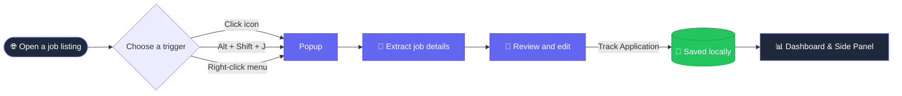
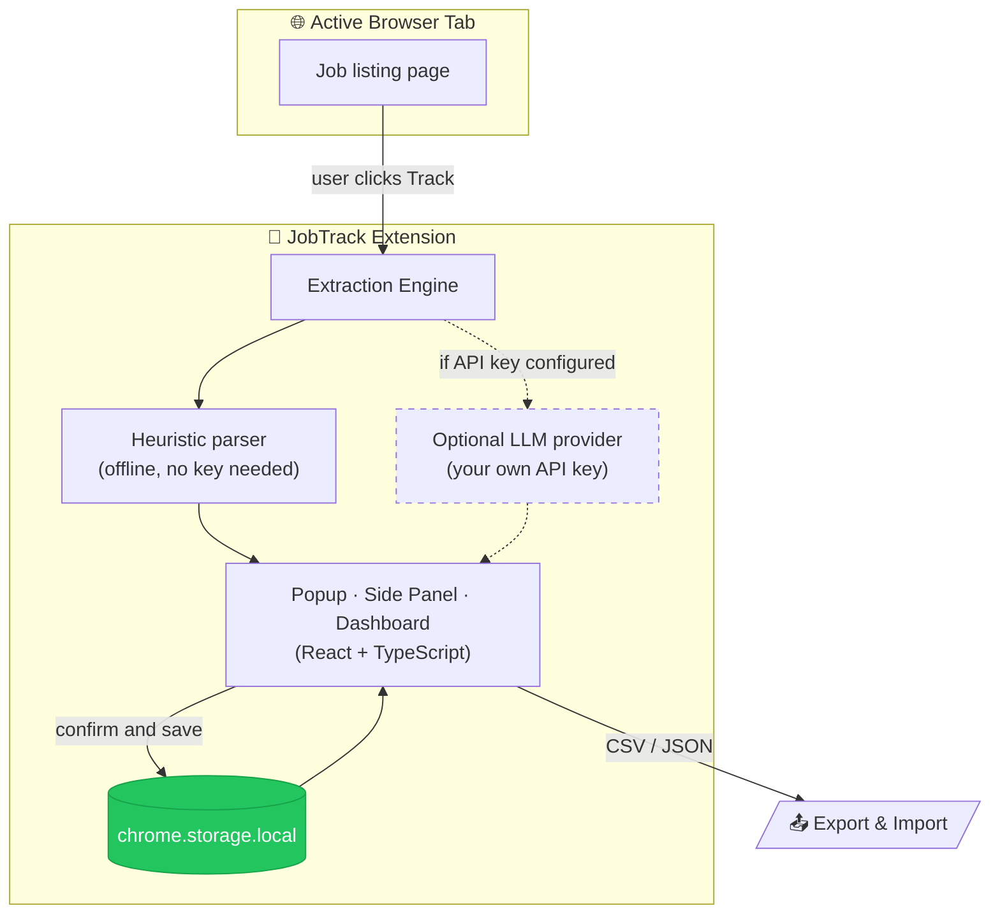

<a id="readme-top"></a>

<div align="center">


### Track every application. One click. Zero guesswork.

A fast, privacy-first Chrome extension that captures job listings from any website and organizes them into a clean application pipeline, entirely on your device.

<br />

[](https://github.com/Harsh031202/jobtrack-chrome-extension)
[](#-installation)
[](#-privacy--permissions)
[](https://github.com/Harsh031202/jobtrack-chrome-extension/stargazers)

[Features](#-features) · [Installation](#-installation) · [How to Use](#-how-to-use) · [How It Works](#-how-it-works) · [Tech Stack](#-tech-stack) · [Development](#-development) · [Privacy](#-privacy--permissions)

</div>

<br />

---

## ✨ Overview

Job hunting means dozens of tabs, scattered notes, and spreadsheets that are always out of date. **JobTrack** fixes that. Open any job listing, press one shortcut, review the extracted details, and save. Your whole search lives in one organized dashboard.

> [!NOTE]
> JobTrack only reads a page **when you ask it to**. It never monitors your browsing and never runs in the background on job sites.

<br />

## 🖼️ Preview

<div align="center">

| Dashboard | Side Panel | Popup |
|:---:|:---:|:---:|
|  |  |  |
| Full pipeline overview | Track while you browse | Quick one-click save |

</div>

<br />

## 🚀 Features

<table>
<tr>
<td width="50%" valign="top">

### 🎯 One-Click Tracking
Save a listing from the popup, the side panel, the right-click menu, or with `Alt` + `Shift` + `J`.

### 🧠 Smart Extraction
Pulls job title, company, location, salary / CTC, and application deadline using structured page metadata (JSON-LD) and optional AI.

### 🛡️ Anti-Hallucination
Missing info is **never guessed**. Unknown salaries and dates stay blank until you fill them in.

### ✅ Review Before Saving
Every extracted field is shown in a confirmation step, so you can edit anything before it lands in your pipeline.

### 🔁 Duplicate Detection
Revisit a listing you already tracked and JobTrack catches it, so there are no double entries.

</td>
<td width="50%" valign="top">

### 📊 Status & Timeline
Follow each application through **Applied → Screening → Assessment → Interview → Offer**.

### 📅 Next Steps at a Glance
Keep deadlines, online assessments, and interview schedules visible and organized.

### 🔎 Instant Search & Filters
Search by role, company, skills, or your own notes.

### 📤 Export & Import
Back up or move your data any time as **CSV** or **JSON**.

### 📴 Works Offline
A built-in heuristic extraction engine works with **no API key** required.

</td>
</tr>
</table>

<br />

## 🌐 Works Everywhere

JobTrack works on the sites you already use, and on any company career page.


<br />

## 📦 Installation

> [!IMPORTANT]
> JobTrack is loaded as an unpacked extension. The ready-to-use build lives in the [`dist`](dist) folder.

<details open>
<summary><b>Load into Chrome (takes under a minute)</b></summary>

<br />

1. Clone the repository or download it as a ZIP.
   ```bash
   git clone https://github.com/Harsh031202/jobtrack-chrome-extension.git
   ```
2. Open Google Chrome and go to `chrome://extensions/`.
3. Turn on **Developer mode** (top right corner).
4. Click **Load unpacked**.
5. Select the **`dist`** folder from this repository.
6. Click the puzzle icon in the toolbar and **pin** JobTrack for quick access.

</details>

<br />

## 🧭 How to Use



### Step by step

| # | Step | What happens |
|:-:|------|--------------|
| **1** | **Open a job listing** | Browse LinkedIn, Indeed, Naukri, Greenhouse, Lever, or any career page. |
| **2** | **Trigger JobTrack** | Click the toolbar icon, press `Alt` + `Shift` + `J`, or right-click and choose **Track application with JobTrack**. |
| **3** | **Review the details** | Check the extracted company, role, salary, and status in the confirmation modal. Edit anything that looks off. |
| **4** | **Save** | Click **Track Application** to add it to your pipeline. |
| **5** | **Manage your search** | Open the **Side Panel** or the **Full Dashboard** any time to update stages and manage interviews. |

> [!TIP]
> Keep the **Side Panel** open next to your job tabs to track and update applications without leaving the page.

<br />

## 🔬 How It Works



**The short version:** the page is read only after you click. Details are extracted locally by default, shown to you for confirmation, and stored in your browser. An external AI model is used **only** if you choose to add your own API key.

<br />

## 🛠️ Tech Stack

<div align="center">


</div>

<br />

## 💻 Development

Want to run it from source or customize it?

```bash
# 1. Install dependencies
npm install

# 2. Start the Vite dev server
npm run dev

# 3. Create a production build (outputs to /dist)
npm run build

# 4. Preview the build
npm run preview

# Regenerate extension icons
npm run generate-icons
```

After building, reload the extension on `chrome://extensions/` to pick up your changes.

<details>
<summary><b>📁 Project structure</b></summary>

<br />

```text
jobtrack-chrome-extension/
├── dist/               # Production build, load this in Chrome
├── public/             # Static assets (extension icons)
├── scripts/            # Helper scripts (icon generation)
├── src/                # React + TypeScript source
├── popup.html          # Toolbar popup entry
├── sidepanel.html      # Side panel entry
├── dashboard.html      # Full dashboard entry
├── index.html          # App entry
├── vite.config.ts      # Vite configuration
├── tailwind.config.js  # Tailwind configuration
├── tsconfig.json       # TypeScript configuration
└── package.json
```

</details>

<br />

## 🔐 Privacy & Permissions

Your job search is personal. JobTrack is built so your data stays yours.

- 🏠 **Local storage only.** Applications, notes, and timelines are stored in your browser with `chrome.storage.local`.
- 🚫 **No tracking.** No analytics, no web history collection, and no selling or sharing of data.
- 🖱️ **Action-only access.** Page content is read only when you explicitly click to track.
- 🔑 **AI is opt-in.** Page text is sent to an LLM endpoint **only** if you add your own API key.

<details>
<summary><b>Why does JobTrack need each permission?</b></summary>

<br />

| Permission | Why it's needed |
|------------|-----------------|
| `storage` | Saves your applications, timelines, notes, and settings on your device. |
| `tabs` | Reads the URL and title of the active tab when you choose to track a job. |
| `scripting` | Runs the extraction script on the active tab only when you click **Track**. |
| `sidePanel` | Shows the JobTrack side panel next to your job tabs. |
| `contextMenus` | Adds the right-click **Track application** shortcut. |
| `http://*/*`, `https://*/*` | Lets JobTrack analyze listings on any company career portal when you ask it to. |

</details>

<br />

## 🗺️ Roadmap

- [x] Popup, side panel, and full dashboard
- [x] Heuristic extraction that works offline
- [x] Optional LLM provider support
- [x] CSV / JSON export and import
- [ ] Chrome Web Store release
- [ ] Reminders for deadlines and interviews

<br />

## 🤝 Contributing

This is my first Chrome extension, so feedback is very welcome. Found a bug or have an idea? [Open an issue](https://github.com/Harsh031202/jobtrack-chrome-extension/issues), or fork the repo and send a pull request.

<br />

## 👤 Author

**DarK** · [@Harsh031202](https://github.com/Harsh031202)

If JobTrack helps your job search, consider giving it a ⭐. It really helps.

<br />

<div align="center">


<a href="#readme-top">↑ Back to top</a>

</div>
